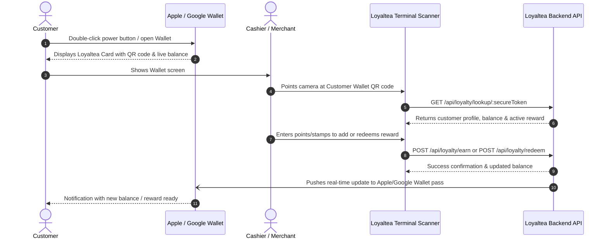

# Loyaltea Design System (DESIGN.md)

This document serves as the authoritative design system specification for **Loyaltea**, providing the core tokens, component guidelines, layout rules, and mobile wallet pass design models for both Apple Wallet and Google Wallet.

---

## 1. Brand Philosophy & Identity

Loyaltea represents digital loyalty made personal, tactile, and simple. The aesthetic combines warm artisan hospitality with sleek, high-reliability fintech interaction.

- **Primary Metaphor**: A digital cardholder / artisan tea house stamp card.
- **Tone**: Welcoming, trustworthy, frictionless, and premium.
- **Bidirectionality**: Equal first-class fidelity for Arabic (Right-to-Left / RTL) and French/English (Left-to-Right / LTR).

---

## 2. Design Tokens

### 2.1 Color Palette

#### Primary Theme: Artisan Emerald & Forest
| Token | Hex | Role / Application |
| :--- | :--- | :--- |
| `color-brand-deep` | `#1b322e` | Deep background tone for high-contrast loyalty cards |
| `color-brand-primary` | `#26433d` | Core brand green, card base gradient start |
| `color-brand-soft` | `#497568` | Secondary green, card gradient stop, focused accents |
| `color-brand-mint` | `#9fcfbf` | Soft mint highlights, eyebrow labels, progress indicators |
| `color-brand-glow` | `#b8e4d6` | High-visibility text on dark card surfaces |

#### Semantic & Neutral Palette (Light Mode Default)
| Token | Variable | Value | Purpose |
| :--- | :--- | :--- | :--- |
| `text-primary` | `--ink` | `#252323` | Main readable body and heading text |
| `text-muted` | `--muted` | `#88817b` | Secondary captions, timestamps, hints |
| `text-faint` | `--faint` | `#a9a39e` | Placeholder text, tertiary descriptors |
| `surface-canvas` | `--paper` | `#fcfbf9` | Page background, warm off-white |
| `surface-card` | `--white` | `#ffffff` | Elevated panels, modal containers, popovers |
| `border-subtle` | `--line` | `#ebe7e2` | Hairline dividers, card outlines |
| `accent-coral` | `--coral` | `#ef735f` | Primary calls to action, badges, alerts |
| `accent-gold` | `--yellow` | `#f2c567` | Star ratings, points milestone badges |

#### Dark Mode Palette
| Token | Variable | Value |
| :--- | :--- | :--- |
| `surface-canvas-dark` | `--paper` | `#121110` |
| `surface-card-dark` | `--white` | `#1d1a19` |
| `text-primary-dark` | `--ink` | `#f6f1ea` |
| `text-muted-dark` | `--muted` | `#b7aaa0` |
| `border-subtle-dark` | `--line` | `#3a3532` |

---

### 2.2 Typography Scale

- **Font Family**: `-apple-system, BlinkMacSystemFont, "Segoe UI", Roboto, "Helvetica Neue", Arial, sans-serif`
- **Weights**: Regular (`400`), Medium (`500`), Semi-Bold (`600`), Bold (`700`)

| Level | Size | Line Height | Tracking | Usage |
| :--- | :--- | :--- | :--- | :--- |
| **Display Hero** | `32px` | `1.2` | `-0.025em` | Customer wallet greeting, hero statements |
| **Heading 1** | `24px` | `1.3` | `-0.02em` | Main section titles, dashboard headings |
| **Heading 2** | `20px` | `1.35` | `-0.015em` | Business card titles, modal titles |
| **Subheading** | `16px` | `1.4` | `normal` | Panel headers, card subheaders |
| **Body Standard**| `14px` | `1.5` | `normal` | Inputs, table rows, descriptions |
| **Caption / Eyebrow** | `12px` | `1.4` | `0.05em` (Caps) | Category pills, model badges, dates |

---

### 2.3 Geometry & Radii

- **Button / Input Radius**: `10px` – `12px`
- **Modal / Dialog Radius**: `16px` – `20px`
- **Loyalty Card Radius**: `18px` – `24px` (harmonizes with physical credit card aspect ratio ~`1.58:1`)

---

## 3. Digital Wallet Pass Specifications

Loyaltea cards are designed to synchronize seamlessly into **Apple Wallet** and **Google Wallet**.

### 3.1 Apple Wallet (`.pkpass`) Pass Model

- **Pass Type**: `storeCard`
- **Visual Palette**:
  - `backgroundColor`: `rgb(38, 67, 61)` (`#26433d` Artisan Green)
  - `foregroundColor`: `rgb(255, 255, 255)` (Clean white text)
  - `labelColor`: `rgb(184, 228, 214)` (`#b8e4d6` Soft Mint)
- **Field Layout**:
  - **Header Field**: Program / Business Name
  - **Primary Field**: `balance`
    - Value: e.g. `322 POINTS` or `8 STAMPS`
    - Label: `BALANCE` (FR: `SOLDE`, AR: `الرصيد`)
  - **Secondary Fields**:
    - `cardholder`: Customer full name
    - `tier`: Active Offer status (e.g. `Free Coffee unlocked`)
  - **Auxiliary Fields**:
    - `member_id`: Membership short card ID / secure token slice
  - **Back of Pass (Details)**:
    - Business address, phone number, WhatsApp link, and loyalty program rules
  - **Barcode**:
    - Format: `PKBarcodeFormatQR`
    - Message: `membership.secure_token` (UUID)
    - Encoding: `iso-8859-1`
    - Alternate Text: Display token for manual teller entry if camera is dirty

---

### 3.2 Google Wallet (`LoyaltyClass` & `LoyaltyObject`) Pass Model

- **Pass Type**: `LoyaltyObject` referencing a business `LoyaltyClass`
- **Visual Palette**:
  - `hexBackgroundColor`: `#26433d`
  - `heroImage`: Brand header illustration or business storefront
  - `programLogo`: Business avatar logo (`logo_url`)
- **Field Layout**:
  - **Header**: Business Name + Program Name
  - **Account Name**: Customer Full Name
  - **Account ID**: `membership.secure_token`
  - **Points / Stamps**:
    - Balance: `${balance}`
    - Label: `Points` or `Stamps`
  - **Barcode**:
    - Type: `QR_CODE`
    - Value: `membership.secure_token`
    - Alternate Text: `membership.secure_token`
  - **Card Links**:
    - Web link to view full Loyaltea history: `https://loyaltea.vercel.app`

---

## 4. Wallet Interaction & Scanning Flow

---

## 5. Bidirectional (Arabic RTL / LTR) Guidelines

1. **Logical Properties**:
   - Never use `left` or `right` directly in CSS layout classes.
   - Use CSS logical properties: `margin-inline-start`, `padding-inline-end`, `border-start-start-radius`.
2. **Numbers & Barcodes**:
   - Phone numbers, secure token UUIDs, and QR codes remain direction-agnostic and LTR-aligned.
3. **Wallet Badges**:
   - Official "Add to Apple Wallet" and "Add to Google Wallet" badges follow official vendor localization guidelines.
